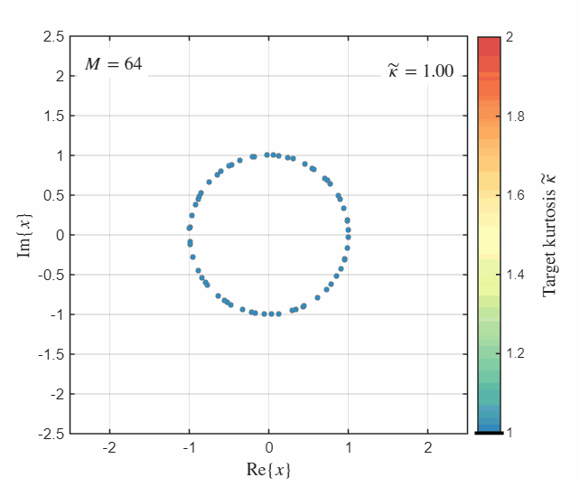

# Constellation Shaping for OFDM-ISAC Systems

This repository provides MATLAB (and Python) code accompanying our work on constellation shaping for OFDM-based integrated sensing and communications (ISAC). In OFDM-ISAC systems, the sensing performance depends on the kurtosis (fourth moment) of the transmit constellation, which leads to a trade-off with the communication performance (mutual information).

The repository contains:
1. **Kurtosis-adaptive constellation family** [1] (folder [`adaptive_constellation/`](adaptive_constellation)): a pretrained, autoencoder-optimized family of geometrically and probabilistically shaped 64-point constellations that can be generated on the fly for any target kurtosis between 1 (unit modulus, sensing-optimal) and 2 (Gaussian-like, communication-optimal). Scripts to reproduce Figs. 2–4 of [1] are included.
2. **Mutual-information bounds under a kurtosis constraint** [2] ([`mi_bounds_kurtosis_constraint.m`](mi_bounds_kurtosis_constraint.m)).

---

## 1. Kurtosis-Adaptive Constellation Family [1]

<p align="center">
  
</p>

The constellation points and probabilities are generated by three small neural networks that take the target kurtosis $\tilde\kappa$ as input. The constellation is parameterized in polar form (Eqs. (12)–(14) in [1]):

- radii: $r(\tilde\kappa) = \max\left(1 + \sqrt{\tilde\kappa - 1}\,\tanh(f_{\mathrm{NN,R}}(\tilde\kappa)),\ \epsilon_\mathrm{R}\right)$
- phases: $\theta(\tilde\kappa) = \tilde\theta + \pi \tanh(f_{\mathrm{NN},\theta}(\tilde\kappa))$, with the uniform grid $\tilde\theta_m = 2\pi(m-1)/M$
- probabilities: $\mathrm{Pr}(\cdot;\tilde\kappa) = \mathrm{Softmax}\left(\min((\tilde\kappa-1)/\epsilon_\mathrm{Pr}, 1)\, f_{\mathrm{NN,Pr}}(\tilde\kappa)\right)$

followed by a normalization to zero mean and unit average power. Only the trained weights and a MATLAB and Python implementation of the forward pass are provided; no training code is required to use the constellations.

### Folder structure

```
adaptive_constellation/
├── matlab/
│   ├── generate_adaptive_constellation.m   % constellation generator (forward pass of the NNs)
│   ├── adaptive_constellation_weights.mat  % trained NN weights (M = 64)
│   ├── functions/
│   │   ├── MI.m                            % MI over AWGN (Gauss-Hermite quadrature)
│   │   └── mi_upper_bound_kurtosis.m       % MI upper bound, Eq. (11) in [1]
│   └── figures/
│       ├── fig2_adaptive_constellation.m   % Fig. 2: constellations vs. target kurtosis
│       ├── fig3_achieved_kurtosis.m        % Fig. 3: achieved vs. target kurtosis
│       └── fig4_mi_vs_kurtosis.m           % Fig. 4: MI vs. kurtosis (2, 6, 10 dB SNR)
└── python/
    ├── adaptive_constellation.py           # generator, MI over AWGN, MI upper bound
    ├── figures.ipynb                       # Jupyter notebook reproducing Figs. 2–4
    └── requirements.txt
```

### Usage

MATLAB:

```matlab
cd adaptive_constellation/matlab
addpath functions
[x, p] = generate_adaptive_constellation(1.5);   % target kurtosis 1.5
kappa = sum(p .* abs(x).^4);                     % achieved kurtosis
mi = MI(x, p, 10);                               % MI over AWGN at 10 dB SNR
```

Python (run from `adaptive_constellation/python`):

```python
from adaptive_constellation import generate_adaptive_constellation, mutual_information
x, p = generate_adaptive_constellation(1.5)      # target kurtosis 1.5
kappa = (p * abs(x)**4).sum()                    # achieved kurtosis
mi = mutual_information(x, p, snr_dB=10)         # MI over AWGN at 10 dB SNR
```

### Reproducing the figures

The scripts in `matlab/figures/` reproduce Figs. 2–4 of [1]. They set up the MATLAB path themselves and can be run from any working directory (Fig. 4 takes about one minute), e.g.

```matlab
run adaptive_constellation/matlab/figures/fig4_mi_vs_kurtosis.m
```

In Python, all three figures are reproduced in the notebook [`python/figures.ipynb`](adaptive_constellation/python/figures.ipynb) (stored with outputs, so the figures can be viewed directly on GitHub).

The MATLAB scripts and the notebook reproduce the curves of the proposed adaptive constellation and the upper bound; the reference curves (kurtosis-specific constellations, Cartesian parameterization, 64-PSK/64-QAM) are not included.

---

## 2. MI Bounds under Power and Kurtosis Constraints [2]

[`mi_bounds_kurtosis_constraint.m`](mi_bounds_kurtosis_constraint.m) numerically evaluates **upper and lower bounds on the achievable mutual information** of complex-valued signaling under **power and kurtosis constraints**. The code computes:
- Lagrange multipliers of the maximum-entropy distribution subject to moment constraints,
- the resulting input and output entropies,
- and corresponding upper and lower mutual-information bounds as a function of the kurtosis constraint.

The implemented numerical procedures correspond to **(23)–(32)** in [2].

---

## Requirements

- MATLAB implementation: MATLAB R2022b or later (tested with R2023b and R2025b)
- Optimization Toolbox (only for `fsolve` in `mi_bounds_kurtosis_constraint.m`)
- Python implementation: Python ≥ 3.9 with NumPy, SciPy, Matplotlib, and Jupyter (`pip install -r adaptive_constellation/python/requirements.txt`)

---

## Note

Parts of this code were refactored with the help of an AI assistant. All results were verified against the data underlying the figures in the paper.

---

## References

[1] B. Geiger, L. Hampel, and L. Schmalen, *"Joint power and adaptive-constellation optimization for OFDM-ISAC systems"*, in Proc. 1st IEEE Conference on Integrated Sensing and Communications (ISAC), Lisbon, Portugal, Nov. 2026. [arXiv:2611.12166](https://arxiv.org/abs/2611.12166)

[2] B. Geiger, F. Liu, S. Lu, A. Rode, D. Gil Gaviria, C. Muth, and L. Schmalen, *"Constellation shaping for OFDM-ISAC systems: From theoretical bounds to practical implementation"*, IEEE Trans. Commun., vol. 74, pp. 6025–6042, Mar. 2026. [doi:10.1109/TCOMM.2026.3669491](https://doi.org/10.1109/TCOMM.2026.3669491), [arXiv:2509.04055](https://arxiv.org/abs/2509.04055)
